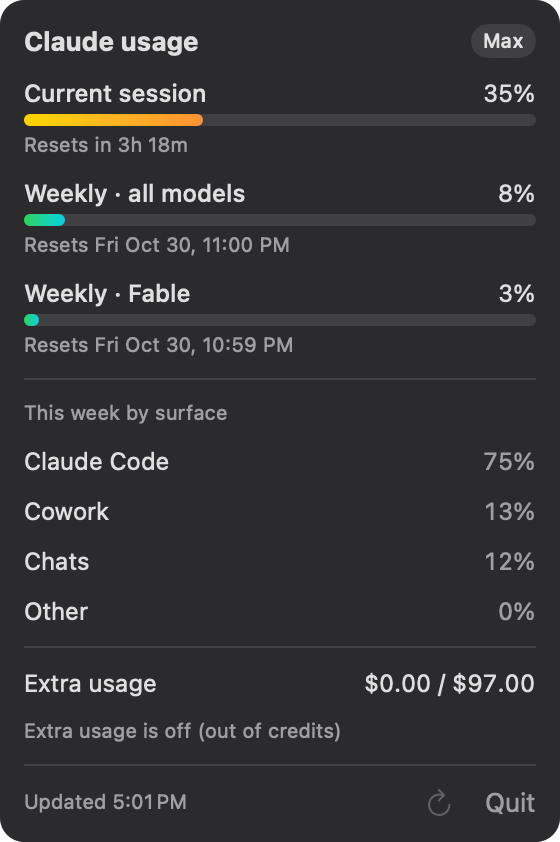

# Claude Usage Bar

A tiny macOS menu bar app that shows your Claude plan usage — the same numbers as `/usage` in Claude Code.




The menu bar shows a glowing dot with your current **Session** and **Weekly** percentages stacked beside it. Click it for the full breakdown:

- Current session, weekly (all models) and any per-model weekly limits, each with a bar and reset time
- This week's usage split by surface (Claude Code, Chats, Cowork, …)
- Extra usage spend and whether it's on

The dot is a little lava lamp: two colors slowly swirl inside it while its glow drifts between them. The colors follow whichever limit is highest:

| Usage | Colors |
|---|---|
| under 33% | green ↔ teal |
| 33–79% | yellow ↔ orange |
| 80%+ | red ↔ purple, and a bit faster |

The animation runs in Core Animation at about 8 fps, so the app itself uses no CPU for it; drawing it cost macOS roughly 2% of one core when measured at 12 fps, and the lower cap only reduces that. To save battery, the dot only animates while your Mac is plugged in. On battery, or with **Reduce Motion** turned on in Accessibility settings, it stays still (still colored), and it picks back up as soon as that changes.

It refreshes on launch, every 5 minutes, and whenever you open it, but never more than once a minute (see [Rate limits](#rate-limits)).

## Requirements

- macOS 14+
- Xcode command line tools (`xcode-select --install`)
- Claude Code installed and logged in with a Claude subscription (`claude`, then `/login`)

## Build and install

```bash
./build.sh --install
```

This builds `ClaudeUsage.app`, copies it to `~/Applications`, and launches it. Run `./build.sh` alone to just build into `build/`.

### Launch at login

Create `~/Library/LaunchAgents/com.gil.claude-usage-bar.plist`:

```xml
<?xml version="1.0" encoding="UTF-8"?>
<!DOCTYPE plist PUBLIC "-//Apple//DTD PLIST 1.0//EN" "http://www.apple.com/DTDs/PropertyList-1.0.dtd">
<plist version="1.0">
<dict>
  <key>Label</key><string>com.gil.claude-usage-bar</string>
  <key>ProgramArguments</key>
  <array>
    <string>/usr/bin/open</string>
    <string>/Users/YOU/Applications/ClaudeUsage.app</string>
  </array>
  <key>RunAtLoad</key><true/>
</dict>
</plist>
```

Then load it:

```bash
launchctl bootstrap gui/$(id -u) ~/Library/LaunchAgents/com.gil.claude-usage-bar.plist
```

## How it works

It reads the OAuth token Claude Code stores in your login keychain (`Claude Code-credentials`, via `/usr/bin/security`, so there's no keychain prompt) and calls the same usage endpoint `/usage` uses. It never refreshes or writes the token — if it has expired, run any `claude` command and it'll pick up the new one.

This endpoint isn't a documented public API, so a Claude Code update could change it and break the app.

### Rate limits

The usage endpoint is rate limited, and that limit is shared with Claude Code itself (`/usage` and anything else it checks with your login). Opening the popover over and over, or relaunching the app many times in a row, can get you an HTTP 429.

To stay under it, the app:

- fetches at most once every 60 seconds, so opening the popover again within a minute just shows the last result
- honors the server's `Retry-After` header when it gets a 429, up to 15 minutes, so a long one can't freeze the numbers for hours
- keeps showing the last good numbers, with a gray "Rate limited, showing data from …" note, instead of an error

The refresh button is disabled until the next fetch is allowed; hover it to see when.
